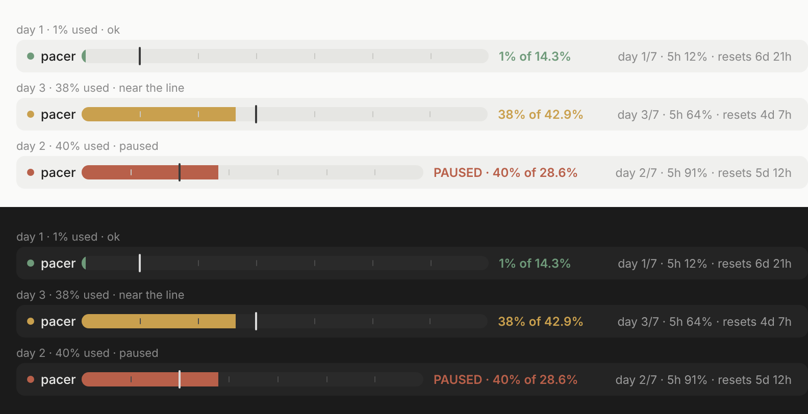

# usage-pacer

A [Claude Code mod](https://code.claude.com/docs/en/plugins/mods) that paces the weekly usage limit day by day for the projects you choose.



Claude Code's weekly limit is one pool for the whole account. A side project can drain it in two evenings and leave nothing for the work that pays. usage-pacer gives such a project a daily allowance instead: on day N of the 7-day window a *paced* project may run only while the account's usage is at or below `N × 14.3%`. Once usage is ahead of that line, the paced project is paused: new prompts are dropped, running tool calls are denied and the turn is aborted. Projects you did not mark are never touched, so your main work gets whatever is left.

The figure is the same `seven_day` reading `/usage` shows, so usage from claude.ai, the desktop app and other sessions counts. The day is derived from the window's reset time, not the calendar.

## Install

In a Claude Code terminal session, add the [ref/claude](https://github.com/ref/claude) marketplace once, then install:

```
/plugin marketplace add ref/claude
/plugin install usage-pacer@ref
```

Pick the user scope, then accept or change the two settings. The mod is active in that session right away and in every session after.

To try it from a local clone instead:

```
claude --plugin-dir /path/to/claude/plugins/usage-pacer
```

Requires Claude Code 2.1.287 or later and a Claude Pro or Max subscription (API-key accounts report no rate limits, so the mod stays idle). Tested with 2.1.301.

## Use

Inside a project you want paced:

```
/pacer on        # pace the current directory
/pacer status    # day of the window, % used, % allowed, list of paced projects
/pacer off       # stop pacing the current directory
```

While a paced project is open, one row above the prompt shows the week as a progress bar: a marker at today's pace line, faint ticks for each day, then `38% of 42.9%` and `day 3/7 · 5h 64% · resets 4d 7h`. The desktop app draws a rounded bar; the terminal draws `█░` cells. The colour is a muted traffic light: sage on track, amber within 15% of the line, brick past it (`PAUSED`).

Paced projects are stored by their absolute path (the directory you start `claude` in) and shared across sessions.

## Settings

Shown in `/config` under the plugin, or asked at install time:

| Option | Default | Meaning |
| --- | --- | --- |
| `daily_percent` | 14.3 | Percent of the week a paced project may have used per day elapsed. Lower it to reserve more for unpaced work: with 10, paced projects can use at most 70% of the week by day 7. |
| `block_tools` | true | Also deny tool calls and abort the turn when the line is crossed mid-turn. Off: only new prompts are blocked. |

## How it works

- `$.session.usage()` and the `session.measure` event give the account's rate-limit windows as the last API response reported them.
- `prompt.submit` drops a prompt in a paced project that is over the line; `tool.call` denies tool calls and aborts the turn.
- `ui.render` on `AbovePrompt` draws the bar: an `Svg` element on the desktop, `Text` cells in the terminal.
- The list of paced paths lives in `$.store`, the last reading in `$.state`.

A single long turn can overshoot the line a little before the next check, since the figure is only as fresh as the last API response.

## Develop

```
claude plugin validate .
claude plugin test
```

Tests live in `tests/` and run against Claude Code's own engine with no session or network.

## License

MIT, see the [repository's LICENSE](../../LICENSE).
